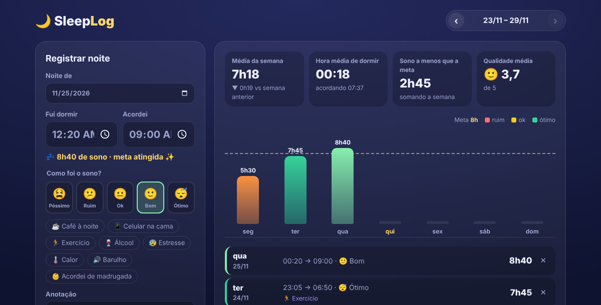

# SleepLog — Diário de sono

Registre a hora de dormir e de acordar, avalie a qualidade do sono e veja o gráfico da semana.

🔗 **[Ver o site no ar](https://iamviniciuslima05.github.io/PROJETO-SleepLog/)**



## Funcionalidades

- Registro de **hora de dormir e de acordar**, inclusive passando da meia-noite
- **Qualidade** do sono de 1 a 5 e **hábitos** da noite (café, celular, exercício…)
- **Gráfico da semana** com cores pela qualidade e linha da meta
- **Média de sono**, horário médio de dormir e **sono a menos** que a meta
- Meta de **6 a 9 horas**
- Navegação entre semanas

## Tecnologias

HTML5 · CSS3 · JavaScript · localStorage

## Estrutura

```
index.html
css/style.css
js/script.js
```

## Como rodar

Não precisa instalar nada: baixe o projeto e abra o `index.html` no navegador, ou acesse a versão publicada acima.

---
Feito por **Vinicius Lima** · [Portfólio](https://viniciuslimadev.netlify.app) · [LinkedIn](https://www.linkedin.com/in/viniciuslima25/)
